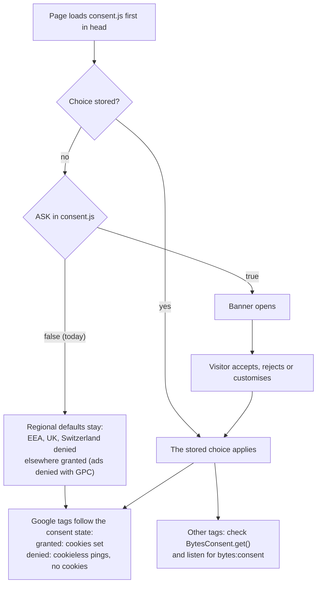

# Add a tracking tag

Use this when you want to add Google Analytics, Google Ads, a Meta pixel or any other third-party tag. Today no tag on
the site sets analytics or marketing cookies, so the banner stays closed on a first visit. A new tag changes that, so
the owner decides first.

## How consent.js works

`bytes-website/public/consent.js` is Google Consent Mode v2 plus the banner. It loads first in `<head>` on the
homepage, the four legal pages and onboarding. Checked against the code on 17 Oct 2026:

- **Defaults, set before any tag runs.** In the EEA, the UK and Switzerland, analytics and ads are denied until the
  visitor chooses. Everywhere else, analytics is granted, and ads are granted unless the browser sends Global Privacy
  Control. Google works out the visitor's region. With no tag on the site, these defaults change nothing today.
- **A stored choice** is applied again on every page. It lasts 180 days and is kept in `localStorage`, with a
  `bfx_consent` cookie as the fallback. Raising `VERSION` makes everyone choose again.
- **On every choice** it sends a Consent Mode `update`, calls `fbq('consent', 'grant')` or `'revoke'` if a Meta pixel is
  already on the page, pushes a `consent_update` event to `dataLayer`, and fires a `bytes:consent` window event.
- **For your own code:** `window.BytesConsent.get()` returns the stored choice, an object whose `analytics` and
  `marketing` are true or false, or `null` if there is none. `.open()` opens the settings, and `.reset()` clears the
  choice and asks again.
- **With `ASK = true`** the banner opens for every visitor with no stored choice, in every region: after their first
  scroll, tap or key press, or after 2.5 seconds. With `ASK = false` it opens only from a Cookie Settings link (any
  element with `data-cookie-settings`, as in the footer) or from `BytesConsent.open()`.

## Steps

1. **Get the owner's decision.** Say which tag and what it stores. Also ask whether visitors outside the EEA, the UK and
   Switzerland keep today's default (granted until they choose). That default is already in `consent.js`. Keeping or
   changing it is the owner's call, and the cookie policy has to describe whichever is chosen.
2. **Turn the banner on.** In `consent.js`, set `ASK = true` and raise `VERSION` by one.
3. **Allow the tag in the Content Security Policy.** Today `bytes-website/public/_headers` allows `script-src 'self'`,
   `connect-src` only to crm-api and chatbot-api, and images from any `https:` address. Add the vendor's script and
   connect addresses. Vendors publish them; for Google tags, see Google's guide to using a Content Security Policy.
4. **Keep scripts external.** The site runs no inline scripts. Put the tag's setup lines (for Google, the
   `gtag('js', new Date())` and `gtag('config', 'G-…')` calls) in a file under `public/` and load it with
   `<script src>`. `consent.js` already defines `window.gtag` and `window.dataLayer`.
5. **Place the tag after `consent.js`,** on every page that loads `consent.js`:
   - **Google tags:** load them in `<head>` after `consent.js`. Consent Mode then decides what they store.
   - **Meta pixel:** call `fbq('consent', 'revoke')` before `fbq('init', …)`, then grant if
     `BytesConsent.get()?.marketing` is true. `consent.js` handles later choices, but its first call runs before the
     pixel exists. (This follows from reading the code; check it when you add the pixel.)
   - **Any other tag:** load it only when `BytesConsent.get()` says yes, and on the `bytes:consent` event.
6. **Update the legal pages.** They say the site uses no analytics or advertising cookies, and the cookie policy says
   there is no banner. Change:
   - `bytes-website/public/cookie-policy.html`: list each new cookie with its name, provider, purpose and lifetime, and
     say how the regional default works. Its `og:description` and `twitter:description` say "No analytics or
     advertising cookies" too
   - `bytes-website/public/privacy-policy.html`, section 8
   - `bytes-website/public/data-deletion.html`, if it describes what is removed
7. **Check it.** In the browser console, run `BytesConsent.reset()` and confirm the banner opens. Google's Tag Assistant
   shows the consent default and each update. After **Reject**, a Google tag still sends cookieless pings but sets no
   cookies (DevTools, Application, Cookies). After **Accept**, its cookies appear. A visit from the UK starts with the
   denied default; most other regions start granted.
8. **Run the checks** in [Run the tests](run-the-tests.md), then ask the owner before merging.

## Why the order matters

`consent.js` must run before any tag, because it sets the defaults the tags read. A tag placed above it runs with no
consent state and can set cookies before the visitor has agreed. That would break the cookie policy and the privacy
policy.
