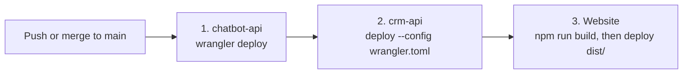

# Deploy

**Every push to `main` deploys to production.** The workflow is `.github/workflows/deploy-worker.yml`, named
"Deploy Agency" in GitHub Actions. Merging a pull request is a deploy. Check the run in the Actions tab after each merge.

## What runs, in order

1. **chatbot-api** deploys first, because crm-api binds to it.
2. **crm-api** deploys second, with `--config wrangler.toml`. Without that flag, Wrangler deploys the website's config in
   its place.
3. **The website** deploys last, as static assets from `bytes-website/dist`.

Each step installs Wrangler 4.149.0, which needs Node 22 or newer on the runner. The runner is pinned to `ubuntu-24.04`
(not `ubuntu-latest`) so that the runner image does not change under the deploy.

The `CLOUDFLARE_API_TOKEN` secret lives in GitHub, and it is the only secret the workflow uses. The workflow does not set
Worker secrets.

## Before you merge

1. Run the checks in [Run the tests](run-the-tests.md).
2. If you changed a secret's name or added one, set it in the worker's folder first. The deploy does not set secrets:
   `npx wrangler secret put NAME` (add `--config wrangler.toml` in crm-api). See
   [section 4 of the knowledge base](../knowledge-base.md#4-configuration-and-secrets).
3. If you changed `plans.json`, all three parts bundle or copy it, so it goes live step by step: chatbot-api first (chat
   limits, mode caps, and the prices the Bytes bot quotes), then crm-api, then the website's Pricing section. Check the
   Pricing section after the deploy.

## After you merge

- Open the "Deploy Agency" run and confirm all three steps are green.
- If a step fails, the live site may be half-updated: chatbot-api can be new while crm-api is still old. Read the failed
  step's log before you push a fix.
- If the deploy worked but broke something, see [Roll back a deploy](rollback.md).

## Things to know

- Keep the `plans.json` import in crm-api as a plain `import x from '../../public/plans.json'`. Do not add
  `with { type: 'json' }`: the test runner rewrites that exact line.
- The Wrangler version is pinned in the workflow (4.149.0). The action's own default (3.90) is too old for
  `wrangler.jsonc`, so do not remove the pin.
- The crm-api `package.json` migration scripts (`migrate:local`, `migrate:remote`) name a database, `crm-database`,
  that the config does not bind. `migrate:local` stops with an error and changes nothing (checked on 17 Oct 2026;
  `migrate:remote` was not run). Use `chatbot-db` instead, as in
  [Run locally](run-locally.md#crm-api) and [Run a data fix](run-a-data-fix.md). The open items in the
  [knowledge base](../knowledge-base.md#11-open-items-and-known-gaps) list it.
