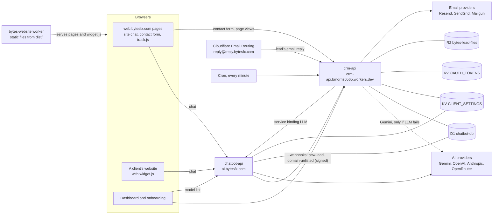
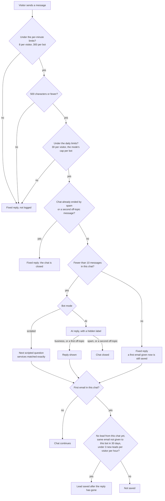
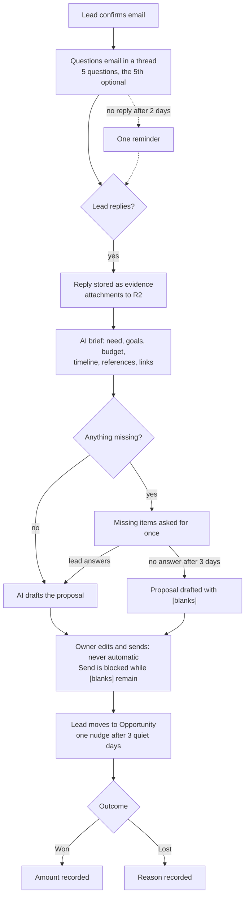

# BytesFX knowledge base

This is the reference for the whole project: what each part does, where it lives, how the pieces talk to each other,
and what is configured where. For step-by-step tasks, see [How-to guides](how-to/README.md). When something breaks,
see [Troubleshooting](troubleshooting.md). For the overview, see the [project README](../README.md).

**Last checked:** 17 Oct 2026, against `main` at `a1029f6`. Sections 4 to 7 and 9 were checked claim by claim against the
code. What only a real phone, a mailbox or the live site can show (keyboard behaviour, inbox tabs, link previews) comes
from `HANDOVER.md` and says so. `HANDOVER.md` is the owner's running log; this page is the reference. Change this page
in the same pull request as the code it describes. Where the two disagree, the code is right.

Contents:

1. [What the project is](#1-what-the-project-is)
2. [Repository map](#2-repository-map)
3. [Architecture](#3-architecture)
4. [Configuration and secrets](#4-configuration-and-secrets)
5. [Data](#5-data)
6. [Plans, bot modes and limits](#6-plans-bot-modes-and-limits)
7. [Features, by area](#7-features-by-area)
8. [External setup](#8-external-setup)
9. [Testing and checks](#9-testing-and-checks)
10. [Conventions](#10-conventions)
11. [Open items and known gaps](#11-open-items-and-known-gaps)

---

## 1. What the project is

BytesFX (Bytes Enterprises Ltd, London) is an agency website plus a small SaaS product. Three parts:

- **The website** is the agency homepage: services, process, a Pricing section, a contact form and a chat box.
- **The chatbot product** lets a business sign up, get a chat widget for its own website, and capture leads. Its
  owner manages it in the **dashboard**: leads, conversations, proposals, analytics and settings.
- **The sales follow-up engine** (the CRM). A verified lead is emailed questions. Replies come back by email. An AI
  drafts a proposal, and a person reviews it and sends it. Won and Lost outcomes are tracked, with analytics.

| URL | What it is |
|---|---|
| `https://web.bytesfx.com/` | The website (Vite build of `bytes-website/`) |
| `https://web.bytesfx.com/dashboard/` | The dashboard, for admins and clients |
| `https://web.bytesfx.com/onboarding/` | Self-serve signup and the 7-day trial |
| `https://web.bytesfx.com/plans.json` | The shared plan list (section 6) |
| `https://crm-api.bmorris0565.workers.dev` | The CRM API worker (`crm-api`) |
| `https://ai.bytesfx.com` | The chatbot API worker (`chatbot-api`) |

Admins are listed in the `ADMIN_EMAILS` variable in `bytes-website/crm-api-worker/wrangler.toml`.

The Bytes website's own chatbot has the client ID `default`. Its prompt and settings are treated as the "house" bot.

---

## 2. Repository map

```
README.md                          Project overview, quick start and how to contribute
docs/                              This knowledge base, troubleshooting and the how-to guides
ARAMID.md                          The commit gate: what it checks and its commands
HANDOVER.md                        Owner's running handover log (kept up to date by hand)
CLAUDE.md                          Frontend rules: design guardrails and the screenshot workflow
wrangler.jsonc                     Website worker: serves bytes-website/dist as static assets
.github/workflows/deploy-worker.yml   CI: deploys chatbot-api, then crm-api, then the website, on every push to main

chatbot-api/                       Chat worker (TypeScript), at ai.bytesfx.com
  src/index.ts                     Chat endpoint, bot modes, scripted flow, website gate, LlmService (RPC)
  src/llm.ts                       Model catalogue (prices, premium flag) and provider calls
                                   (Anthropic, OpenAI, Gemini, OpenRouter)
  test/                            node test/run.mjs: 3 suites (chat, gate, scripted)
  schema.sql                       Early tables (leads, chat_logs, email_sequences); crm-api's migrations/ cover them too
  wrangler.jsonc                   D1, KV, the two rate limiters, and an hourly cron whose handler does nothing on purpose

bytes-website/                     The website and its static assets
  index.html                       Homepage markup (including the site's own chat box)
  src/main.js                      Homepage code: sections, Pricing, the site chat, the contact form (built by Vite)
  src/home.css, src/style.css      Homepage styles, both imported by main.js
  style.css                        Linked from index.html; holds the phone rules for the site chat (see section 7)
  og-src/                          Source for the link-preview images (not deployed)
  public/                          Copied as-is into dist (not bundled)
    plans.json                     THE plan list: prices, limits, features
    widget.js                      Chat widget that client websites load
    share.js, consent.js, track.js Share button, cookie banner, cookieless page-view beacon
    dashboard/                     Dashboard (vanilla JS, about 4,200 lines)
    onboarding/                    Signup flow
    privacy-policy.html and other legal pages
    _headers                       Security headers and the Content Security Policy
  crm-api-worker/                  CRM worker (Hono, plain JavaScript), at crm-api.bmorris0565.workers.dev
    src/index.js                   Auth, leads, sales flow, mail, analytics, admin, crons
    src/auth.js                    OAuth providers (Google, Facebook, LinkedIn)
    migrations/                    0001 to 0003; some tables and columns are created in code instead (section 5)
    data-fixes/                    One-off SQL for the live database, run by hand
    test/                          node test/run.mjs: 15 suites
    wrangler.toml                  Config for crm-api (use --config wrangler.toml with Wrangler)

research/                          Notes and analysis; not used by the build
```

---

## 3. Architecture



The two workers share one D1 database and the `CLIENT_SETTINGS` KV namespace. crm-api reaches the AI models through
chatbot-api's `LlmService` (a service binding), so model calls go through one place. It calls Gemini itself only when
that binding is unavailable.

**Cloudflare resources** (account `107ddadecf5d982d0dc11c72affcce79`):

| Resource | Binding | Used by | Name or ID |
|---|---|---|---|
| D1 database | `DB` | both workers | `chatbot-db` (`83348fa4-873f-4b07-b372-6a6e3b0896b6`) |
| KV namespace | `CLIENT_SETTINGS` | both workers | `cffce7f12c7248f7935c31f7c591c726` |
| KV namespace | `OAUTH_TOKENS` | crm-api | `8ad06a763d6745d1bbbbd7fce1f4eb6c` |
| R2 bucket | `FILES` | crm-api | `bytes-lead-files` (lead attachments) |
| Service binding | `LLM` | crm-api | `chatbot-api`, entrypoint `LlmService` |
| Rate limiters | `CHAT_LIMITER`, `CLIENT_LIMITER` | chatbot-api | set in `chatbot-api/wrangler.jsonc` |

**Deploy order:** chatbot-api first, because crm-api binds to it. Then crm-api, then the website. Section 9 and the
[deploy guide](how-to/deploy.md) have the details.

---

## 4. Configuration and secrets

Secret values are never stored in the repo. Set them from inside the worker's own folder, with
`npx wrangler secret put NAME`. The names below are the ones the code reads.

**crm-api** (`bytes-website/crm-api-worker`). Add `--config wrangler.toml` to every Wrangler command in this folder.
Without it, Wrangler uses the website's `wrangler.jsonc` in the repo root and acts on the wrong worker.

| Secret | Purpose |
|---|---|
| `JWT_SECRET`, `OAUTH_STATE_SECRET` | Signs sessions and OAuth state |
| `ADMIN_SECRET` | Admin key login. TOTP 2FA is kept in KV under `totp:secret` |
| `GOOGLE_CLIENT_ID`, `GOOGLE_CLIENT_SECRET` | Google sign-in |
| `FACEBOOK_CLIENT_ID`, `FACEBOOK_CLIENT_SECRET` | Facebook sign-in |
| `LINKEDIN_CLIENT_ID`, `LINKEDIN_CLIENT_SECRET` | LinkedIn sign-in |
| `GEMINI_API_KEY` | Fallback used when the `LLM` binding is unavailable |
| `RESEND_API_KEY`, `WEBSITE_MAIL_FROM`, `WEBSITE_MAIL_NAME` | The Bytes website's email sender. A sender saved in Settings takes priority |

Variables in `wrangler.toml`: `ALLOWED_ORIGINS`, `AUTH_REDIRECT_URL`, `FRONTEND_*_URL`, `REPLY_DOMAIN`
(`reply.bytesfx.com`), `ADMIN_EMAILS`.

**`ALLOWED_ORIGINS` and a local page.** The list holds the origins allowed to call crm-api from a browser, and it
includes `http://localhost:5173` and `http://localhost:3000` so a dev server can reach it. The session cookie is
`SameSite=None`, so the browser sends it with any request from those ports — which would let any process on the
machine serve a page there and act as the signed-in owner. Since 27 Oct 2026 the cookie is therefore **ignored for a
local origin**: only the JWT in the `Authorization` header counts there, and a local page cannot read that (it lives
in the dashboard's own storage). The dashboard still works locally, because it sends both.

**chatbot-api**:

| Secret | Purpose |
|---|---|
| `GEMINI_API_KEY` | Required. The default model and lead extraction use it. Without it, a chat that needs the AI returns 503 |
| `OPENAI_API_KEY`, `ANTHROPIC_API_KEY`, `OPENROUTER_API_KEY` | Optional providers. A model whose key is missing shows "(no API key)" |
| `ADMIN_API_KEY` | Keys the scrambled visitor ID used for the per-visitor chat limits (`visitorKey`). **It must stay set.** Without it every chat gets a 503, because an ID made with a fixed key could be matched back to an IP address. Changing it only resets that day's counts |

Each client saves its own email sender (Resend, SendGrid or Mailgun) in the dashboard. It is stored in KV under
`mail:<clientId>`.

**Development-only variables.** Leave both unset in production. The build fails if either is set in a worker's config
(`bytes-website/crm-api-worker/test/sec.mjs` reads both config files and checks).

| Variable | Worker | Effect |
|---|---|---|
| `ALLOW_LOCALHOST` | chatbot-api | `1` lets pages on `localhost` and `127.0.0.1` use any bot, as `web.bytesfx.com` can |
| `NODE_ENV` | crm-api | Nothing reads it any more. It used to turn on `/api/force-test-webhook`, a debug route that inserted a test lead; that route was removed on 27 Oct 2026. The dashboard's "Test lead" button does the same job |

Local development secrets go in `.dev.vars` or `.env` files in the worker's folder. Both are git-ignored, so they are
never committed. Neither worker has one today.

---

## 5. Data

**D1 tables** (database `chatbot-db`):

- `leads`, `chat_logs`, `email_sequences`, `crm_settings` (plan, trial dates, campaign mode, auto-approve)
- `users`, `roles`, `automations`, `email_templates`
- `page_views`: cookieless visit records, with country, device, browser, source and campaign
- `lead_messages`: the email thread, plus scheduled tasks stored as `direction='task'`
- `lead_files`: lead attachments

**Schema made by migrations.** `bytes-website/crm-api-worker/migrations/` holds three files:

- `0001_init.sql`: `leads`, `chat_logs`, `email_sequences`, `roles`, `automations`, `users`, `email_templates`,
  `crm_settings`
- `0002_plan_trial.sql`: `crm_settings` columns `plan`, `trial_started_at`, `trial_ends_at`
- `0003_page_views.sql`: `page_views`. Optional: crm-api's `ensurePageViews()` also creates it on first use.

`chatbot-api/schema.sql` holds an early copy of `leads`, `chat_logs` and `email_sequences`. chatbot-api's
`wrangler.jsonc` names a `migrations` folder that does not exist.

**Schema made by the code, on first use** (not in any migration):

- crm-api `ensureSales()`: the `lead_messages` and `lead_files` tables, and ten `leads` columns: `thread_token`,
  `brief`, `replied_at`, `last_reply_at`, `outcome`, `deal_value`, `lost_reason`, `closed_at`, `unsubscribed`,
  `proposal`
- chatbot-api `ensureSchema()`: the `leads.session_id` column, and the `chat_logs` columns `session_id`, `flag` (the AI's
  label for the message) and `visitor` (the scrambled visitor ID), plus indexes. It creates no tables. crm-api's
  `/api/logs` leaves `visitor` out of what it returns.

So the migrations alone do not give the live schema. A fresh database matches production only after both workers have
run.

**KV keys:**

| Key | Namespace | Holds |
|---|---|---|
| `client:<id>` | `CLIENT_SETTINGS` | The bot's configuration: company name, mode, system prompt, model, effort, services, allowed domains, branding, widget settings, questions, booking link, alert email, drafting and reading models |
| `mail:<id>` | `OAUTH_TOKENS` | A client's email sender |
| `email_client:<email>` | `OAUTH_TOKENS` | Maps an owner's email to a client ID |
| `migr:bot-modes-v1` | `OAUTH_TOKENS` | One-time mode-migration flag |
| `unlisted:<id>:<domain>` | `OAUTH_TOKENS` | Set once the "used on a website that is not on your list" alert has been sent |
| `unlisted:<id>:sent` | `OAUTH_TOKENS` | Set for 7 days after an alert, so the owner gets at most one a week |

Other `OAUTH_TOKENS` keys hold session and login state: `device:*`, `totp:*`, `setup:*`, `exchange:*`, `pending_2fa:*`.

---

## 6. Plans, bot modes and limits

**`bytes-website/public/plans.json` is the single source of truth.** Change prices and limits there and nowhere else.
Three places read it:

- crm-api, bundled into the worker
- chatbot-api, bundled, for the chat limits, the daily cap of each bot mode, and the prices and trial the Bytes bot
  quotes
- the website's Pricing section (imported by Vite), and the dashboard and onboarding (`fetch('/plans.json')`)

| Plan | Price | Bot mode | Websites | Leads | AI follow-ups | Hide badge | White label |
|---|---|---|---|---|---|---|---|
| Free | $0 | Scripted | 1 | 10/day, 50 total | – | – | – |
| Starter | $29/mo | AI | 3 | unlimited | ✓ | – | – |
| Pro | $79/mo | AI | 10 | unlimited | ✓ | ✓ | – |
| Business | $149/mo | AI Plus | 25 | unlimited | ✓ | ✓ | ✓ |
| Enterprise | custom | AI Plus | 50 | unlimited | ✓ | ✓ | ✓ |

No plan allows more than 50 websites. A saved list is cut to 50 on every plan: on `POST /api/installations`, on the
admin's `POST /api/config` and on `/api/site-settings`.

`"featured": true` (on Pro today) marks the recommended plan. The Pricing section gives it the "Recommended" badge and
the filled button. Move the flag to change the recommended plan.

**Bot modes:**

| Mode | Messages per day | Notes |
|---|---|---|
| `scripted` | 400 | Guided questions built from the client's Services list |
| `ai` | 2,000 | |
| `ai_plus` | 5,000 | Allows premium models (output price above $15 per 1M tokens) |

Older mode names map across: `free` and `standard` become `scripted`; `pro` becomes `ai`; `elite` becomes `ai_plus`.

**Chat limits** are the same on every plan. The first four are in `plans.json` under `chat`:

| Limit | Value | Notes |
|---|---|---|
| Messages per chat | 10 | Later messages get a fixed reply with no AI call. A first email typed after that is still saved as a lead |
| Characters per message | 500 | Both chat boxes stop typing there and show a count. The server refuses longer messages |
| Messages per visitor per day, per bot | 30 | The visitor is a keyed hash of their network that changes daily (`chat_logs.visitor`) |
| New leads per visitor per hour, per bot | 3 | Each new lead sends a confirmation email. A lead over the limit is not saved |
| Messages per visitor per minute, per bot | 8 | `CHAT_LIMITER` in `chatbot-api/wrangler.jsonc`, not `plans.json` |
| Messages per bot per minute, all visitors | 300 | `CLIENT_LIMITER` in `chatbot-api/wrangler.jsonc` |
| Messages per bot per day | 400, 2,000 or 5,000 | Set by the bot mode (table above) |

The server checks them in this order: the two per-minute limits, the message length, the daily limits, then whether the
chat is still open. A visitor's network is their IPv4 address, or the first half (/64) of an IPv6 address (`netOf`).
All three per-visitor limits count the network, so changing address inside one IPv6 network does not reset them.

Fixed replies (over a limit, chat closed, AI unavailable) are not written to `chat_logs`, so they do not use up the
daily allowance. The one exception is a first email typed after the 10-message limit: that message is logged and the
lead is saved.

**Chat IDs.** The server creates each chat's ID, and the browser keeps it in the tab. An ID the browser sends is reused
only when this chatbot has saved messages under it in the last 6 hours. Any other ID (made up, belonging to another
chatbot, or idle too long) is replaced with a new one. Whoever holds a live ID can continue that chat. The ID is not
tied to the visitor's network, on purpose, so a phone that changes network keeps its chat.

**Plan rules** (crm-api `entitlements()`, `modesForPlan()`, `syncBotMode()`):

- **Trial:** 7 days, and it only matters on the Free plan. A trial gives AI replies and AI follow-ups on Free limits
  (1 website, badge on). A paid plan always gets its own entitlements, even during a trial.
- **Admin-only settings:** bot mode, AI model, effort and the sales email models are set by admins only, in Manage
  Clients. Clients see them read-only, and their saves never change them.
- **Plan changes:** the bot moves to the new plan's top mode. A downgrade forces the badge on, strips white-label
  fields and cuts the saved website list to what the new plan allows (the first websites are kept). The list is also
  cut when an admin saves a client's websites, and an hourly pass cuts any list left over from an earlier downgrade.
- **Plan changes are manual.** There is **no payment integration**. Admins change plans in Manage Clients. "Choose
  <plan>" on the Pricing section pre-fills the contact form.

---

## 7. Features, by area

Each entry says where the code is. Start there before changing anything.

### Website (`bytes-website/src/main.js`)

- **Homepage sections and the site's chat box.** Markup is in `index.html`. `public/widget.js` is a separate embeddable
  widget for client websites. A change to one usually belongs in both.
- **Pricing** is built from `plans.json`. `?upgrade=<plan>&client=<id>#pricing` highlights a plan and pre-fills the request.
- **Contact form** posts to `POST /api/public/website-lead`.

**Cookie banner** (`public/consent.js`, loaded first in `<head>` by the homepage, the four legal pages and onboarding):

- Since 17 Oct 2026 it does not open on a first visit (`ASK = false`). No tag on the site sets analytics or marketing
  cookies: the CSP in `_headers` runs only the site's own scripts, and the visit statistics are cookieless.
- The footer's Cookie Settings link opens it.
- It is Google Consent Mode v2. Before any tag runs it sets defaults: analytics and ads denied in the EEA, the UK and
  Switzerland; elsewhere analytics granted, and ads granted unless the browser sends Global Privacy Control. With no
  tag on the site, these defaults change nothing today.
- The choice is kept in `localStorage`. A copy is also written to a cookie, and that cookie is only read when browser
  storage is blocked — it is a fallback, not the record. So a cookie planted by another site (a sibling
  `bytesfx.com` host, for example) grants nothing on its own. On https the cookie carries the `__Host-` prefix, so
  only this exact host can set it.
- For code: `window.BytesConsent.get()` returns the stored choice or `null`; `.open()` opens the settings; `.reset()`
  clears the choice and asks again.
  Every choice fires a `bytes:consent` window event and a `consent_update` `dataLayer` event.
- Before adding Google Analytics, Google Ads or a pixel, set `ASK = true`, bump `VERSION` so everyone is asked again,
  and update the cookie policy, the privacy policy (section 8) and the data-deletion page. Those pages currently say
  the site sets no analytics or marketing cookies and shows no banner.
- **The build checks this.** `bytes-website/scripts/check-consent.mjs` fails the build when the CSP allows a
  third-party script, or a page loads one from another host, while `ASK` is false. `bytes-website/scripts/test-consent.mjs`
  checks the cookie rules. Both run in `npm run build`, and so in the deploy workflow.
- How-to: [Add a tracking tag](how-to/add-a-tracking-tag.md).

**Link previews and the Share button** (`public/share.js`):

- The homepage, the legal pages and onboarding each have their own `og:` and `twitter:` tags.
- Images: `public/og-home.jpg` (homepage and legal pages) and `public/og-trial.jpg` (onboarding). Both are 1200×630
  JPEGs of about 80 KB, made from `bytes-website/og-src/`. They are not deployed from there. Instructions for remaking
  them are at the top of `og-src/home.html`.
- X shows only the image, with no title or description, so the offer has to be in the picture. LinkedIn and Facebook
  share links take only the address, so their text comes from `og:title` and `og:description`.
- A changed image needs a new filename, because platforms cache previews by address. `og-image.png` is kept for posts
  that already show it.
- The legal pages' Share button shares the homepage, through `data-share-path="/"` on `<html>`.
- Shared and copied links carry `utm_source=<target>`. crm-api's `UTM_NAMES` gives each a name in Analytics.
  `track.js` removes the `utm_*` tags from the address bar once the visit is counted.
- Only the platforms' own tools show what each platform really displays: Facebook's Sharing Debugger and LinkedIn's
  Post Inspector, run against the live site.
- How-to: [Remake the share images](how-to/remake-share-images.md).

**Site chat on phones.** Both chat boxes fill the screen: the widget at 480px wide and under, the site chat at 768px
and under. Neither shows its launcher while open. The × closes the chat.

- The site chat is styled by two stylesheets, both loaded: `bytes-website/style.css` (linked from `index.html`, holds the
  phone rules) and `bytes-website/src/style.css` (imported by `main.js`). A limit in one can undo a rule in the other,
  so check both.
- While a phone's keyboard is up, `fitToView` (in `src/main.js` and `widget.js`) sizes the chat to the part of the screen
  still visible. A test on a desktop browser cannot prove the keyboard behaviour; a real phone is the only proof.
- On a phone the site hides its chat while the cookie banner is up (560px and under), so a local check has to answer the
  banner first.

**Site menu on phones.** The burger menu covers the screen and closes when one of its links is tapped. The listener is
in the mobile-menu code in `src/main.js`. Links to a section scroll without changing the page address (`initSmoothScroll`),
so anything that waits for the address to change will not run after a tap on one of them.

### Chat widget and chatbot-api

- **Website gate (`siteGate`).** A bot answers only on its saved websites, plus `web.bytesfx.com` for previews (and
  `localhost` when `ALLOW_LOCALHOST=1`). Elsewhere the chat gets a 403. The Bytes bot (`default`) answers on
  `web.bytesfx.com` and nowhere else. A client bot with an empty website list answers nowhere: nothing is saved
  automatically, so a site that reached the bot first cannot claim it. The owner is told once, through
  `/api/webhooks/domain-unlisted`, and adds the website themselves. Onboarding requires a website, so only bots set up
  before that rule have an empty list.
  - The 403 carries no CORS header, so the browser keeps the body from the page. The widget shows its own
    "not connected" message for a response it cannot read.
- **Question order:** need, then name and email in one question, then timeline, then budget. The email is asked for
  twice at most. The design notes are in the "Chatbot Conversion Design" artifact,
  `https://claude.ai/code/artifact/dc745756-cf9a-4083-99c7-3dc8d084490c` (private to the owner's claude.ai account;
  ask the owner for a copy).
  - Scripted bots, the Bytes bot and an AI bot with no prompt of its own (`clientDefaultParts`) all follow this order.
  - A client's AI bot with its own prompt (40 characters or more, once lines with unfilled `[blanks]` are dropped)
    follows that prompt. For the Bytes bot, any saved prompt counts. The sign-up prompt (`starterPrompt` in
    `public/onboarding/main.js`) asks only for name and email, so a bot left on it does not ask for timeline or budget.
- **Service choices.** When a chat opens, both chat boxes show the bot's services as buttons under a one-line greeting,
  then a "Something else" button that puts the cursor in the text box.
  - The list comes from `/public/config` (`services`: 8 at most, 60 characters each). The Bytes bot falls back to
    Websites, Web applications, AI chatbots (`HOUSE_SERVICES`) when none are saved. A bot with no services shows no buttons.
  - A tap sends the service name as an ordinary first message, so it counts toward the 10 per chat and 30 per day.
    Script bots match it exactly (`matchService`). AI bots are told which choices are on screen (the `CHOICES` part of
    the prompt).
  - The buttons appear only for a new chat, and disappear as soon as a message is sent.
- **Keyboard on phones.** On touch devices neither chat selects its text box when it opens, so the keyboard stays down
  and the greeting and choices have the screen. Both text boxes are 16px on touch devices, because iPhones zoom in on
  smaller ones.
- **Off-topic and spam.** The AI starts each reply with a hidden label: `[business]`, `[offtopic]` or `[spam]`. The code
  removes it and stores it in `chat_logs.flag`. Spam closes the chat at once, and so does a second off-topic message.
  Without AI, a message with no letters or numbers, or with 3 or more links, gets a nudge.
- **Lead capture.** A lead is saved on the message that carries the email. Never from spam, and never for a placeholder
  address such as `test@test.com`. One lead per chat, and the same email on the same bot is not saved twice within 30
  days. One SQL statement checks all of this and saves, so two chats sent at the same moment cannot both pass.
  - AI bots: `gemini-2.5-flash-lite` reads the chat for name, need, budget and timeline, and reads it again two messages
    later to update the lead.
  - Script bots: the script updates the lead as timeline and budget arrive.
  - An update never replaces a known value with an empty one, and never changes the email.
  - Nothing a visitor can see depends on the `leads` table. Every visitor who gives an email gets the same confirmation
    sentence, and the lead is saved after the reply has gone (`keepLead`, in `ctx.waitUntil`). Otherwise a reply would
    reveal whether an address is already a lead for that business.
- **Prompts.**
  - The Bytes prompt (`HOUSE_ABOUT`, `HOUSE_STEPS`, `HOUSE_FACTS`, `HOUSE_RULES`) is used only for `default`, and only
    while no usable prompt is saved for it: any saved prompt with text left, once lines with unfilled `[blanks]` are
    dropped, replaces it. Plan prices and the trial length are
    filled in from `plans.json`.
  - Client bots without a usable prompt get `clientDefaultPrompt()`, built from company name, services and booking link.
  - Every AI bot, clients' own prompts included, also gets the security rules, the topic rules and a `THIS TURN` block
    (message number, whether an email was given, and the confirmation sentence to say when the email arrives).
  - The leak guard (`leaksPrompt`) covers the instructions only, so a reply can quote prices and links.
- **Scripted bot (`scriptedTurn`).** Works out where a chat is by replaying the visitor's messages from `chat_logs`. It
  cannot answer questions and says so.
- **Where the chat sends people.** The contact form (`#contact`) on the Bytes website, or a client's booking link. When a
  client has no booking link, the reply is "the contact form on this website". LinkedIn is offered only when a visitor asks
  for a person.

**From a visitor's message to a saved lead:**



Either way the visitor sees the same confirmation sentence, so a reply never shows whether an address is already a lead.

### Leads, the close-the-sale flow and email

**Leads board** (dashboard, Leads): a Kanban board with Inbox, Priority, Opportunity, Campaigns and Closed columns, plus
filters, CSV export and a lead drawer.

**Close-the-sale flow** (crm-api sales section: `startCloseFlow`, `handleInboundEmail`, `handleSalesCron`):

1. **Verification and questions.** The lead confirms their email. They then get a **questions email** in a thread: five
   questions, the fifth optional (examples and references). Replies go to `reply+<token>@reply.bytesfx.com`. A reminder is
   sent after 2 days.
2. **Replies** arrive through Email Routing and are stored as evidence. Attachments go to R2. Only images, PDFs and Office
   files are kept, up to 10 MB per file and 25 MB per lead. Anything else is skipped, and the lead is asked for a Drive or
   Dropbox link.
3. **Brief.** An AI reads the reply for need, goals, budget, timeline, references and links. Anything missing is asked for
   **once**. If there is no answer after 3 days, the proposal is drafted with `[blanks]` in it.
4. **Proposal.** Drafted by AI for every lead who replies, and **never sent automatically**. The owner edits it in the
   drawer. Send is blocked while any `[blanks]` remain. Once sent, the lead moves to Opportunity, gets one nudge after 3
   quiet days, and a "yes" reply is flagged.
5. **Won or Lost** records an amount or a reason. Analytics shows reply rate, win rate, revenue won and time to close.
6. **Stop rules.** Follow-ups stop on a reply, on Won or Lost, or on unsubscribe. Every automatic email after the
   questions email carries an unsubscribe link and a `List-Unsubscribe` header.



**Built-in follow-ups** (`generateRuleSequence`): three short emails in the business's name, mentioning the service the
lead asked about. `autoSequence` uses them when the campaign mode is `rule`, when it is `ai` but the plan has no AI
follow-ups, and when the AI write fails. Mode `manual` sends nothing automatically. The Bytes site can store its own
version as a row in `email_templates` called "Standard Web Design Sequence" under client `default` or `agency_demo`. It
is optional, and a template under any other client is never used for Bytes.

**Email that reaches the inbox.** Gmail's tab placement is the mailbox's own decision. The parts the code controls:

- The confirmation email ("Please confirm your email") and the lead's thread ("Your enquiry with <business>") are two
  separate conversations on purpose. The owner decided this on 12 Oct 2026. Do not merge them.
- The three places that tell a visitor to look for these emails also mention Promotions and Spam: the chat's
  confirmation sentences (`CONFIRM` in chatbot-api), the website form's thank-you message (`src/main.js`), and the page
  shown after confirming (`confirmedNext` in crm-api).
- The questions email carries no unsubscribe link and no `List-Unsubscribe` header (`optOut: false`). It answers the
  enquiry the lead has just confirmed. Those two things are what a mailbox reads as bulk mail.
- Greetings: every email opens with the lead's first name. A lead who gave no name shows as "Visitor" in the dashboard,
  and emails then say "Hi there,".

**Screens a lead reaches from an email link** (crm-api `verifyPage` and `PAGE_CSS`): confirm, confirmed, a link that
cannot be used, an error, and the two unsubscribe screens. They share one frame.

- The look follows the website's own colours and fonts, copied by hand from `bytes-website/src/home.css`. A change to the
  site's palette has to be copied here too.
- They serve every client's leads. The business's name shows as text. There is no BytesFX logo and no per-client colour.
- No script runs on them. Opening a link only shows a button, and the POST does the work, because email scanners open
  every link. For the confirm link, a second press or opening it again shows "Link already used". A second press of
  Unsubscribe shows "You're unsubscribed" again, because that link's token is not erased.
- How to see them on your machine: [Preview email-link pages](how-to/preview-email-link-pages.md).

**Brand name.** The product is BytesFX in everything a client sees: emails, the widget badge, the dashboard, onboarding,
the login setup page and authenticator apps. The old name was replaced on 11 Oct 2026.

- Emails name the business from the bot's saved company name (`companyNameFor`). With no name saved, the Bytes bot
  (`default`) and the demo client `agency_demo` fall back to "BytesFX"; other clients get no name. A sender with no
  name saved also goes out as "BytesFX".
- The crm-api `brand` test fails if the old name appears under `chatbot-api/` or `bytes-website/`, even when it is split
  across tags. Besides the test file itself, two places are allowed: the chat worker's repair of badge links saved under
  the old domain, and the data fix below.
- Stored email text is not changed by a deploy. The one-off fix is in `crm-api-worker/data-fixes/`. How to run it is in
  [Run a data fix](how-to/run-a-data-fix.md).

### Analytics (cookieless)

- `public/track.js` sends one beacon per page view to crm-api's `/api/public/pageview`. Nothing is stored in the browser.
- Visitors who send Do Not Track or Global Privacy Control are not counted.
- A page view is counted only from an `https` address in crm-api's `ALLOWED_ORIGINS`. The reply has to be marked
  `cross-origin`, or the browser blocks it and logs a failed request on every page, although the view is already saved.
- The country comes from Cloudflare (`cf.country`). The IP address is not stored with the record. Records are deleted
  after 400 days (about 13 months).
- Pages served over `http` (a local copy) and the dashboard send no page views (`track.js`).
- The dashboard's Analytics page shows chat, lead and visitor statistics, and the sales results. The Countries card
  shows the top 10.

### Settings and Manage Clients (dashboard)

- **Settings** (admin, for the Bytes website): bot behaviour and mode, services, sales follow-up, the website email
  sender, and the status bar (reply tracking and file storage, with a warning at 8 GB).
- **Manage Clients** (admin): plan and trial, bot mode, model and effort, services and chatbot settings, a test lead,
  and **Delete client**, which needs a typed confirmation and removes the D1 rows, R2 files and KV keys.
- **Client Chatbot page:** install code and websites, behaviour (read-only), services, campaigns and sales follow-up,
  and the email sender.

### Scheduled jobs (crm-api crons)

crm-api's only cron trigger runs every minute (`wrangler.toml`). The hourly jobs run on the run whose minute is 07 (UTC).

- **Every minute:** verification emails, drip sequences, sales tasks (reminders, checkpoints, detail timeouts, proposal
  nudges), and trial expiry (Free → scripted).
- **Hourly, at :07 UTC:** page-view retention, lead-file cleanup (90 days after Lost, or after 90 quiet days; Won keeps
  its files), and the one-time mode migration.

chatbot-api also has an hourly cron trigger, but its handler does nothing on purpose: crm-api sends the drip emails, so
the two workers never both work through a sequence.

---

## 8. External setup

Done already. Repeat only if the account changes.

- **Email Routing** for `reply.bytesfx.com`: subdomain added with MX records, **subaddressing on**, and the rule
  `reply@reply.bytesfx.com` → Worker `crm-api`. Settings → status bar shows "Reply tracking on".
- **R2** bucket `bytes-lead-files`.
- **Resend** key set for the website sender.
- The setup guide (deploy steps, keys, Resend, Email Routing) is in the artifact
  `https://claude.ai/artifact/DobRk3xrWQUcF73NJ5jkCo` (private to the owner's claude.ai account; ask the owner for a
  copy).
- Production data was reset on 10 Oct 2026. The test leads and chat logs were deleted.

---

## 9. Testing and checks

Requires **Node 22.5 or newer** (the tests use `node:sqlite`). Run `npm install` in each worker's folder first.

| Check | Command (from the folder shown) | What it proves |
|---|---|---|
| crm-api tests | `bytes-website/crm-api-worker`: `node test/run.mjs` | All 15 suites (240 checks on 17 Oct 2026) |
| One or a few crm-api suites | `node test/run.mjs flow plans` | Only the named suites |
| chatbot-api tests | `chatbot-api`: `node test/run.mjs` | 3 suites: `chat` (whole requests to the chat endpoint), `gate` (website gate), `scripted` (135 checks on 17 Oct 2026) |
| Typecheck | `chatbot-api`: `npx tsc --noEmit -p .` | TypeScript types |
| Bundle check | `bytes-website/crm-api-worker`: `npx wrangler deploy --dry-run --config wrangler.toml` | Nothing is deployed. It should list the DB, KV, R2 and LLM bindings. "No bindings found" means it checked the website worker instead |
| Website build | `bytes-website`: `npm run build` | Builds the site and copies `public/` |

The crm-api suites, with what they cover:

| Suite | Covers |
|---|---|
| `flow` | Close-the-sale |
| `prop` | Proposals |
| `files` | Attachments and completeness |
| `delc` | Delete client |
| `sec` | Security |
| `t` | Auth and onboarding |
| `modes` | Plan-based modes |
| `plans` | Plan limits |
| `site` | Signup website and adoption email |
| `brand` | The BytesFX name in emails and code, and the one-off data fix |
| `seq` | Follow-up emails that are not AI-written |
| `pv` | Page views from the website |
| `greet` | How emails greet a lead, with and without a name |
| `find` | The screen after confirming, and the questions email it names |
| `pages` | The screens reached from an email link |

The suites run the worker in Node with `node:sqlite`, with mocked KV, R2, mail and LLM. They run against a scratch copy in
`test/.build`, which is git-ignored. The runner treats every `.mjs` file in `test/` (other than `run.mjs`) as a suite, so
keep helper scripts elsewhere. On Windows that folder can stay locked while a local server holds it open, so stop any
local server before running the tests.

**UI checks:** follow the screenshot workflow in `CLAUDE.md`. Use Playwright against `vite preview`, with crm-api and the
model-catalogue requests mocked. Never point a UI check at production.

---

## 10. Conventions

- **Plans live in one file.** Change prices and limits in `plans.json` only.
- **Admin-only settings stay admin-only.** Bot mode, model and effort are never changed by a client's save.
- **No inline scripts.** The Content Security Policy in `public/_headers` allows only the site's own scripts
  (`script-src 'self'`). Styles and fonts may also come from Google Fonts, and pages may call only crm-api and
  chatbot-api (`connect-src`).
- **Design follows `CLAUDE.md`:** a custom palette, layered shadows, no `transition-all`, and hover, focus and active
  states on every clickable element.
- **Branches and pull requests:** work on a branch, run the tests in section 9, commit, push, and open a pull request.
  Merge with **squash**. Each merge to `main` deploys automatically, so check the "Deploy Agency" action.
- **The commit gate (aramid).** Git hooks run aramid on every commit and push (see `ARAMID.md`). Run
  `aramid check --staged` before committing. Never pass `--no-verify`: it switches off the secret scan too. A result
  that lists "skipped (degraded tools)", such as a `gitleaks-inline` timeout, is not a pass: run it again.
- **Commit messages:** a clear subject, then a bullet body. Do not put AI model names in commits or pull requests.

---

## 11. Open items and known gaps

The owner's full list, with the detail, is in `HANDOVER.md` section 11. The main points:

- **Payments.** There is no payment integration. Plans are set by admins. A Stripe checkout is an idea, not built.
- **Test clients.** On 12 Oct 2026 `HANDOVER.md` listed seven test clients to delete with the Delete client button
  (not re-checked here: that needs the live dashboard).
- **Lead-limit caps.** Paid plans say "unlimited". Caps would be added in `plans.json`; enforcement already reads them.
- **Plan change and websites.** Fixed on 27 Oct 2026: a downgrade now cuts the saved website list to the new plan's
  limit at once (and an hourly pass repairs a list left over from an earlier downgrade). Before that, a downgrade kept
  the list until the client next saved it, so the widget kept working on websites the new plan did not include.
- **Free plan after the trial.** AI email work (the questions email, reply reading and proposal drafts) has no plan check.
  Only campaigns are held back.
- **Pricing copy against the code.** Some claims on the Pricing section are not enforced by code (for example, premium
  models on Business and Enterprise). `HANDOVER.md` section 11, item 11, lists them.
- **Chat limits are starting points.** The 10-message limit is a judgement, not a research figure. Review it after about
  100 real chats.

Found while writing and checking these docs, 17 Oct 2026 (not changed):

- **chatbot-api does not start under `wrangler dev`.** The local runtime stops with "Incorrect type for map entry
  'SALES_DEFAULT_MODEL': the provided value is not of type 'function or ExportedHandler'". `src/index.ts` exports string
  constants next to the worker's handlers. Deploys are not affected. Until the code changes, chatbot-api is checked
  with its tests only. See [Run locally](how-to/run-locally.md).
- **crm-api's migration scripts fail.** Both `migrate:*` scripts in `bytes-website/crm-api-worker/package.json` name
  `crm-database` and leave out `--config wrangler.toml`. No config in the repo has a database of that name, so Wrangler
  stops with "Couldn't find a D1 DB with the name or binding 'crm-database'" and changes nothing. The working command is
  `npx wrangler d1 migrations apply chatbot-db --local --config wrangler.toml` (checked locally).
- **The two webhooks are signed.** chatbot-api calls crm-api's `/api/webhooks/new-lead` and
  `/api/webhooks/domain-unlisted` with a shared secret: the body and a timestamp are signed together (HMAC-SHA256) and
  the signature travels in `X-Bytes-Signature` and `X-Bytes-Timestamp`. crm-api refuses a call with no valid signature.
  The secret is `WEBHOOK_SECRET`, set in both workers with `npx wrangler secret put WEBHOOK_SECRET`. Until it is set in
  both, crm-api answers unsigned calls and says so in the log.
  - crm-api also limits what the webhooks do: `new-lead` acts only on a lead that is under 10 minutes old and not yet
    processed, and `domain-unlisted` only for a website that is not on the bot's list.
- **Unused CSS.** `bytes-website/style.css` still has old `.cookie-banner` rules that nothing uses.
- **Older analytics labels.** Rows saved before the share change keep the old source names ("Whatsapp", "Qr",
  "Native_share"). New rows use the current names.
