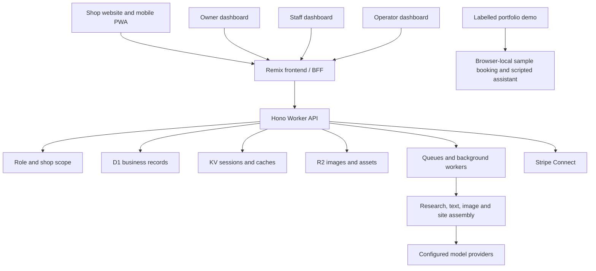

# Pivot Parlor documentation evidence audit

Audited repository: `fbmacagba/Pivot-Parlor`. Pinned commit: `9599fdb4a86b31b43f663fbb4477c51985113ca9`. Audit date: 2026-11-05.

Scope: documentation-only GitHub reads under the user's explicit cross-repository exception. No other-repository source, configuration, runtime, database, or deployment inspection. No changes to that repository. Governance files were treated as documentation evidence, not task instructions. Claims below distinguish documented implementation from roadmap and verification. Raw documents were not copied into this evidence report.

## Publication-ready short brief

Pivot Parlor is a multi-tenant booking and business platform for independent barbershops and beauty salons. It creates a distinct, AI-branded website for each shop, connected to guest booking, staff scheduling, walk-ins, payments, POS, inventory and revenue tools. Owners, staff and platform operators work through dedicated dashboards, with an installable mobile web experience.

## Publication-ready full brief

Pivot Parlor brings a shop's online presence and day-to-day operations into one multi-tenant platform for independent barbershops and beauty salons. Each shop receives its own AI-generated, branded booking website, with shop-specific copy, imagery, typography, colours and page composition. Customers book as guests through the shop's own link, without creating a platform account.

Behind each site, dedicated owner, staff and operator dashboards support services, schedules, appointments, walk-in queues, waitlists and revenue reporting. The documented product also includes optional booking deposits through Stripe Connect, in-store point of sale, retail stock, purchasing, stock-takes, back-bar consumption and item-level returns. A shop-specific AI assistant answers from live business information and guides visitors toward booking.

An operator manages invitation-only onboarding and the generation workflow, including model selection. The platform uses Cloudflare's edge services for its frontend, API, data, assets and background jobs. Its mobile experience is responsive, installable web software.

The current portfolio demonstration is explicitly synthetic: its booking walkthrough creates no appointment or payment, and its assistant uses labelled scripted replies. It demonstrates interface and workflow implementation. Documentation records the wider platform capabilities, while live customer results and full production rollout of every capability remain unverified by this audit.

## Correcting the understated showcase

- This is a reusable multi-tenant SaaS platform that creates and operates many shop sites, rather than one generated barber website. Evidence: [README.md:11](https://github.com/fbmacagba/Pivot-Parlor/blob/9599fdb4a86b31b43f663fbb4477c51985113ca9/README.md#L11), [PRODUCT.md:25](https://github.com/fbmacagba/Pivot-Parlor/blob/9599fdb4a86b31b43f663fbb4477c51985113ca9/apps/web/PRODUCT.md#L25).
- Site uniqueness includes structured page composition and section variants, beyond swapping a logo and colour. The September mobile plan explicitly records the July Design Director and model-picker program as shipped; the current design system describes per-shop tokens, font selection, shape, contrast and motion. Evidence: [mobile plan:11](https://github.com/fbmacagba/Pivot-Parlor/blob/9599fdb4a86b31b43f663fbb4477c51985113ca9/docs/superpowers/plans/2026-09-11-mobile-native-feel.md#L11), [DESIGN.md:339-349](https://github.com/fbmacagba/Pivot-Parlor/blob/9599fdb4a86b31b43f663fbb4477c51985113ca9/apps/web/DESIGN.md#L339), [v3 design:48-146](https://github.com/fbmacagba/Pivot-Parlor/blob/9599fdb4a86b31b43f663fbb4477c51985113ca9/docs/superpowers/specs/2026-07-19-site-design-v3-native-picker-design.md#L48). Do not promise mathematically unique designs for every possible shop.
- The system has public customer journeys and separate operator, owner and staff workspaces, with payments, shop operations and AI orchestration. Evidence: [PRODUCT.md:11-25](https://github.com/fbmacagba/Pivot-Parlor/blob/9599fdb4a86b31b43f663fbb4477c51985113ca9/apps/web/PRODUCT.md#L11), [README.md:25-33](https://github.com/fbmacagba/Pivot-Parlor/blob/9599fdb4a86b31b43f663fbb4477c51985113ca9/README.md#L25).
- “Multi-platform” should be expressed precisely as a multi-surface web/PWA product usable on phones and laptops. Documentation explicitly excludes native iOS/Android apps and lists multi-location support as roadmap. Evidence: [PRODUCT.md:41-44,62-67](https://github.com/fbmacagba/Pivot-Parlor/blob/9599fdb4a86b31b43f663fbb4477c51985113ca9/apps/web/PRODUCT.md#L41), [PRD.md:94-98](https://github.com/fbmacagba/Pivot-Parlor/blob/9599fdb4a86b31b43f663fbb4477c51985113ca9/docs/PRD.md#L94).

## Capability and evidence classification

| Area | Strongest documentation evidence | Safe claim / boundary |
| --- | --- | --- |
| Shop-specific generated frontend | README:11,25; PRODUCT:25,52; DESIGN:339-349; mobile plan:11 | Documented implemented branded sites and v3 composition; no claim of bespoke AI-authored source code |
| Customer booking | PRD:65-76; README:26; PRODUCT:52 | Guest service/staff/slot journey, optional deposits and reminders documented |
| Business operations | README:27-28; PRODUCT:53-54 | Scheduling, bookings, queue, waitlist, POS, inventory, purchasing, stock-takes, consumption, returns documented |
| Payments and money | README:26,28,30,73; PRODUCT:45 | Stripe Connect/deposits/refunds and integer-pence contract documented; live settlements not independently verified |
| Shop-grounded AI | README:29,53; PRODUCT:46,55 | Assistant described as grounded in live shop data; do not claim hallucination is impossible |
| Multi-provider model operations | CLAUDE:228; LLM rollout:9-12,54-85 | Shared text-model routing through OpenRouter and optional direct OpenAI/Anthropic routes documented; keys and manual worker rollout govern availability |
| Roles and isolation | PRD:45-54; PRODUCT:56,60; README:70-73 | Role-specific access and shop-scoped data contract; no absolute security claim |
| Mobile experience | PRODUCT:42,64; DESIGN:264,347-349 | Installable web/PWA, safe areas, mobile booking chrome and reduced-motion behavior documented; no native apps or offline guarantees |
| Legal and operational controls | README:31; DPA record:3-12; DR runbook:137-161 | Published DPA and DR/scaling decisions documented; qualified external legal review deferred |
| Portfolio demonstration | demo plan:31-45 | Recorded tests/browser verification; exact demo journey is synthetic, no-write, scripted chat |
| Customer adoption/results | PRODUCT:76-82 | Pre-launch recorded September 12; no testimonials, case studies or metrics to claim |

## Roles and scope

- Platform operator (`developer`): invitation-only onboarding, shop management, AI generation, model selection, cross-shop support. This is a product role, not a public developer API.
- Shop owner/manager (`admin`): their shop's services, staff, schedules, bookings, queues, settings, stock, sales and revenue.
- Staff: their day, bookings and queue participation.
- Customer: public shop browsing and guest booking, cancellation and queue/waitlist entry. The current PRODUCT says customers never create platform accounts; the older PRD's optional customer account/history language is stale and should not drive new showcase copy.
- Tenant boundary: one shop; shop-scoped reads and writes are documented to filter by shop identity. Operator cross-shop access is deliberate.
- Scope excludes discovery marketplace, self-serve signup, native apps and unsupported verticals. Cross-shop platform operation does not establish multi-location chain management.

Role evidence: [PRODUCT.md:11-21,48-67](https://github.com/fbmacagba/Pivot-Parlor/blob/9599fdb4a86b31b43f663fbb4477c51985113ca9/apps/web/PRODUCT.md#L11), [PRD.md:45-54](https://github.com/fbmacagba/Pivot-Parlor/blob/9599fdb4a86b31b43f663fbb4477c51985113ca9/docs/PRD.md#L45).

## Workflow diagrams

These diagrams describe documented normal-product flows; the isolated synthetic demo branches separately.

```mermaid
flowchart LR
    Operator[Platform operator] --> Onboard[Invite and configure shop]
    Onboard --> Inputs[Services, staff, hours and brand direction]
    Inputs --> Generate[Research and design composition]
    Generate --> Assets[Shop copy and imagery]
    Assets --> Assemble[Validate and assemble shop site]
    Assemble --> Site[Distinct branded booking frontend]
    Site --> Assistant[Assistant grounded in shop data]
    Site --> Guest[Guest service, staff and slot selection]
    Guest --> Deposit{Deposit required?}
    Deposit -->|Yes| Stripe[Stripe payment]
    Deposit -->|No| Booking[Booking record]
    Stripe --> Booking
    Booking --> Reminders[Confirmation and reminders]
    Booking --> Dashboard[Owner and staff operations]
    Dashboard --> Outcome[Completion, cancellation or no-show]
    Outcome --> Revenue[Shop revenue and commission reporting]
```

Generation evidence: v3 spec:142-147; PRODUCT:44; README:11,25-30. Booking and operational evidence: PRD:71-85; PRODUCT:25,45; README:26-30. Deposit-to-booking ordering is a high-level product relationship, not a transaction-level implementation assertion.

Architecture evidence: [README.md:57-86](https://github.com/fbmacagba/Pivot-Parlor/blob/9599fdb4a86b31b43f663fbb4477c51985113ca9/README.md#L57), [CLAUDE.md:215-228](https://github.com/fbmacagba/Pivot-Parlor/blob/9599fdb4a86b31b43f663fbb4477c51985113ca9/CLAUDE.md#L215), [demo plan:7-12,31-45](https://github.com/fbmacagba/Pivot-Parlor/blob/9599fdb4a86b31b43f663fbb4477c51985113ca9/docs/PORTFOLIO-DEMO-PLAN.md#L7).

Reusable nodes: operator; shop onboarding; shop services/staff/hours; research/design; copy/images; site assembly; branded frontend/PWA; shop assistant; guest booking; payment; booking record; reminders; owner/staff workspace; POS/inventory; completion/revenue. Main edges are represented above. POS/inventory forms a parallel in-store operations branch feeding shop reporting, rather than an online retail checkout claim.

## Planned, contradictory and unverified

1. The June PRD and strategy phase labels are not a reliable current completion ledger: they still place POS/deposits/PWA on the roadmap, while the current README and September PRODUCT explicitly identify them as capabilities.
2. July 6 audit/handover found missing live payment plumbing, POS and site uniqueness. Treat those as historical evidence of gaps at that date, superseded in product scope by current README/PRODUCT and later design documentation. Do not repeat them as current defects or silently assume every historical security item is closed.
3. September 11 mobile plan:11 explicitly corroborates July v3/picker delivery. Unchecked procedural steps in implementation plans do not by themselves prove non-delivery or completion.
4. Multi-provider current conventions and rollout runbook support an implemented routing contract, but do not certify that all provider secrets exist or every independently deployed background worker is current.
5. AI receptionist over phone/WhatsApp, smart scheduling, no-show prediction, dynamic pricing, loyalty, multi-location and third-party ecosystem integrations remain roadmap unless stronger dated completion evidence is supplied. PRODUCT:67 explicitly calls the strategy phases non-commitments.
6. Published DPA v1.0 is not independent legal certification. The DPA record:10-12 explicitly defers external legal review.
7. PRODUCT:78 records pre-launch with no live commercial shops or measured results. Older documents call a production test shop “live”; the November demo plan identifies its synthetic demonstration status. Never convert test/demo data into customer proof.
8. The November 4 demo plan records all-workspace checks and bounded browser tests, plus remaining framework dependency findings. Those are historical documented results; this audit ran no product code or runtime checks.
9. No absolute reliability, security, compliance, profitability, performance or AI correctness guarantees are supported. Do not publish internal infrastructure identifiers or detailed security findings in showcase prose.

## Documentation inventory and coverage

Recursive pinned tree returned `truncated: false`. Selected every blob with a documentation extension (`.md`, `.mdx`, `.txt`, `.rst`, `.adoc`): **48 files**. All 48 fetched in full successfully and screened; focused evidence reads prioritize current README/PRODUCT/design conventions, later completion statements, handovers, audits and runbooks. No unread files or fetch failures within this documentation inventory. This is a documentation audit, not source validation; plans contain embedded code, which remains proposal evidence.

| Documentation path | Lines | Coverage |
| --- | ---: | --- |
| `AGENTS.md` | 53 | Retrieved, screened |
| `ANTIGRAVITY.md` | 10 | Retrieved, screened |
| `ARAMID.md` | 216 | Retrieved, screened |
| `CLAUDE.md` | 251 | Retrieved, screened |
| `GRAPHITE.md` | 112 | Retrieved, screened |
| `README.md` | 198 | Retrieved, screened |
| `apps/web/DEPLOY.md` | 26 | Retrieved, screened |
| `apps/web/DESIGN.md` | 375 | Retrieved, screened |
| `apps/web/PRODUCT.md` | 91 | Retrieved, screened |
| `docs/AUDIT-2026-06-15.md` | 377 | Retrieved, screened |
| `docs/AUDIT-2026-07-06.md` | 231 | Retrieved, screened |
| `docs/DASHBOARD_SPEC.md` | 538 | Retrieved, screened |
| `docs/DPA-DRAFT-2026-07.md` | 104 | Retrieved, screened |
| `docs/DR-RUNBOOK.md` | 171 | Retrieved, screened |
| `docs/HANDOVER-2026-06-14.md` | 75 | Retrieved, screened |
| `docs/HANDOVER-2026-07-06.md` | 194 | Retrieved, screened |
| `docs/PORTFOLIO-DEMO-PLAN.md` | 48 | Retrieved, screened |
| `docs/PRD.md` | 145 | Retrieved, screened |
| `docs/STRATEGY.md` | 505 | Retrieved, screened |
| `docs/archive/pivot-parlor-task-list-2026-03-23.md` | 191 | Retrieved, screened |
| `docs/archive/pivot-parlor-task-list-2026-03-24.md` | 218 | Retrieved, screened |
| `docs/archive/pivot-parlor-task-list-2026-03-29.md` | 178 | Retrieved, screened |
| `docs/runbooks/bookings-status-fk-rebuild.md` | 59 | Retrieved, screened |
| `docs/runbooks/e2e-staging.md` | 79 | Retrieved, screened |
| `docs/runbooks/multi-provider-llm-rollout.md` | 87 | Retrieved, screened |
| `docs/runbooks/schema-drift-reconciliation.md` | 36 | Retrieved, screened |
| `docs/runbooks/secret-rotation.md` | 64 | Retrieved, screened |
| `docs/superpowers/plans/2026-06-12-phase-0-1-implementation.md` | 169 | Retrieved, screened |
| `docs/superpowers/plans/2026-06-12-phase-2-implementation.md` | 74 | Retrieved, screened |
| `docs/superpowers/plans/2026-06-12-phase-4-implementation.md` | 94 | Retrieved, screened |
| `docs/superpowers/plans/2026-06-12-remediation-task-list.md` | 111 | Retrieved, screened |
| `docs/superpowers/plans/2026-06-13-phase-5-implementation.md` | 54 | Retrieved, screened |
| `docs/superpowers/plans/2026-06-13-phase-6-implementation.md` | 62 | Retrieved, screened |
| `docs/superpowers/plans/2026-06-13-phase-7-implementation.md` | 28 | Retrieved, screened |
| `docs/superpowers/plans/2026-06-13-phase-8-implementation.md` | 21 | Retrieved, screened |
| `docs/superpowers/plans/2026-07-19-cascaded-model-picker.md` | 1108 | Retrieved, screened |
| `docs/superpowers/plans/2026-07-19-design-director-core.md` | 863 | Retrieved, screened |
| `docs/superpowers/plans/2026-07-19-design-v3-renderer.md` | 382 | Retrieved, screened |
| `docs/superpowers/plans/2026-07-19-design-variants.md` | 2601 | Retrieved, screened |
| `docs/superpowers/plans/2026-07-20-shop-maps.md` | 462 | Retrieved, screened |
| `docs/superpowers/plans/2026-07-21-visual-editor.md` | 2053 | Retrieved, screened |
| `docs/superpowers/plans/2026-09-11-mobile-native-feel.md` | 1890 | Retrieved, screened |
| `docs/superpowers/plans/2026-09-12-multi-provider-llm.md` | 5435 | Retrieved, screened |
| `docs/superpowers/specs/2026-07-19-site-design-v3-native-picker-design.md` | 252 | Retrieved, screened |
| `docs/superpowers/specs/2026-07-20-shop-maps-design.md` | 91 | Retrieved, screened |
| `docs/superpowers/specs/2026-07-21-visual-editor-design.md` | 147 | Retrieved, screened |
| `docs/superpowers/specs/2026-09-12-multi-provider-llm-design.md` | 297 | Retrieved, screened |
| `packages/eslint-config/README.md` | 4 | Retrieved, screened |
